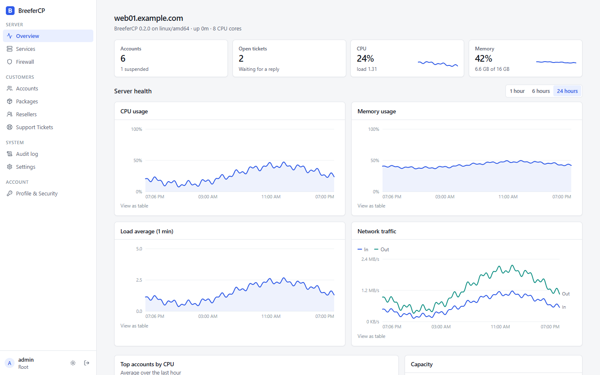
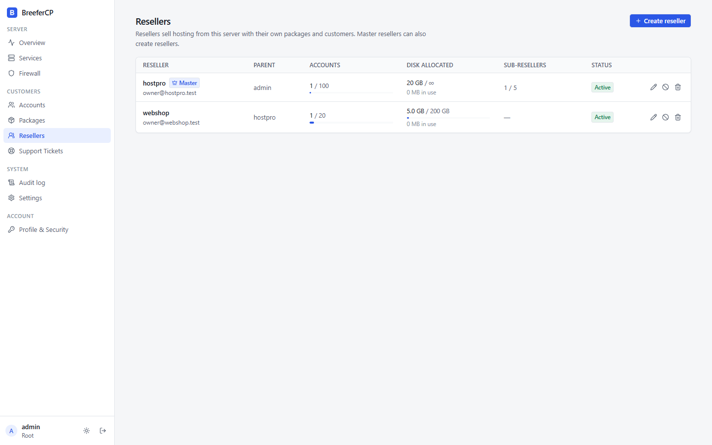
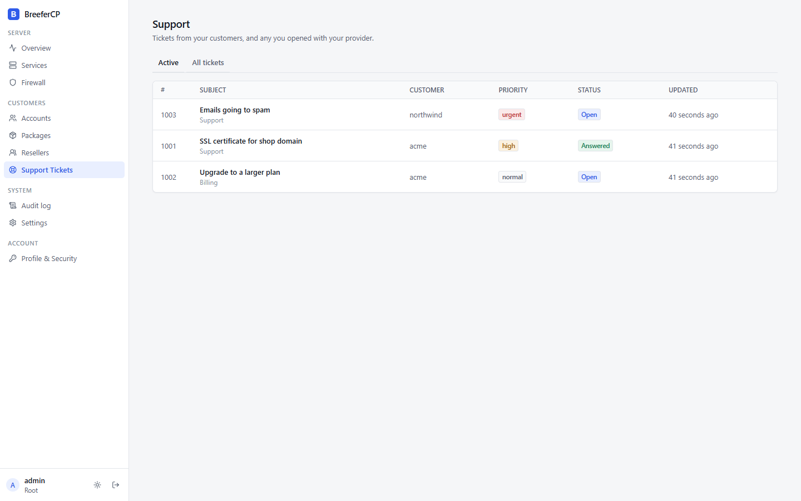
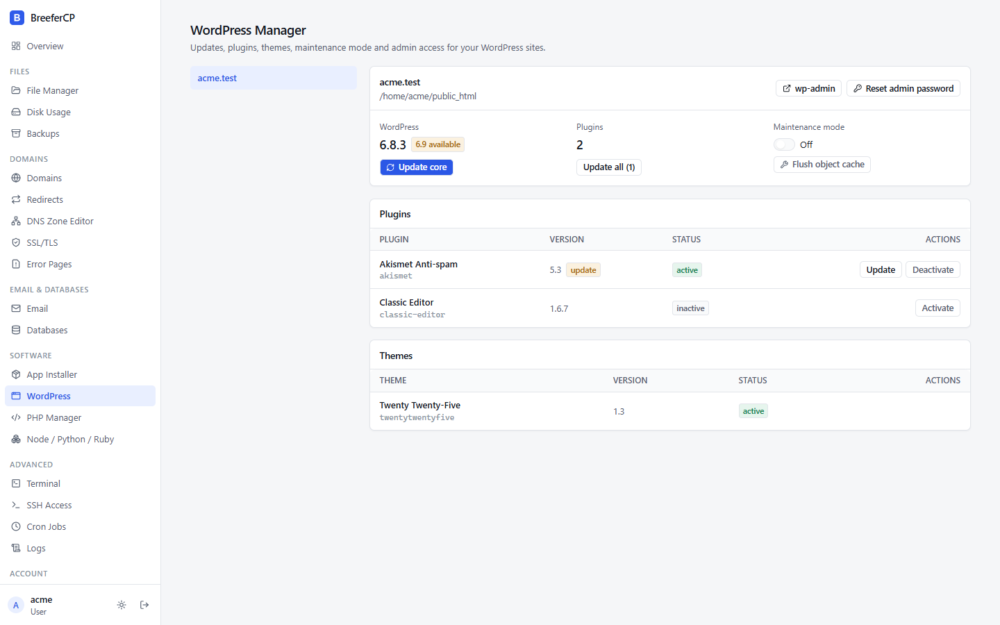
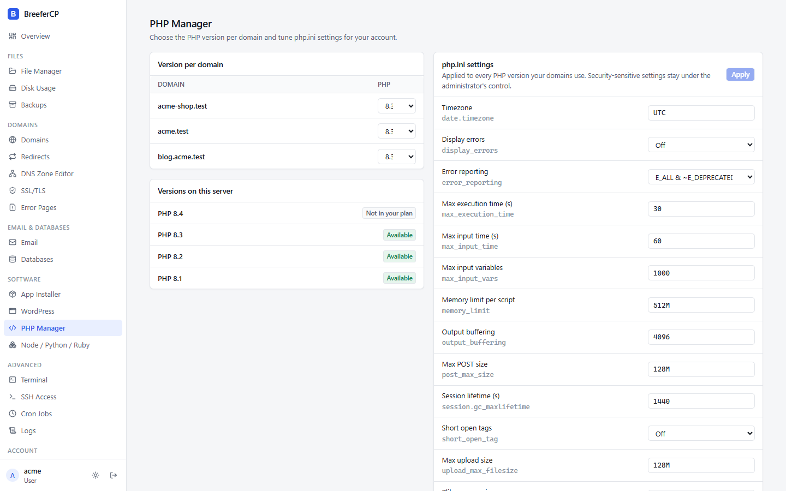

# BreeferCP

A free, open-source web hosting control panel. One panel for the server administrator (the WHM role), master resellers, resellers, and hosting customers (the cPanel role), built on a stack you can read end to end.

- **Backend:** Go. One static binary is the control plane, API, provisioner and metrics collector.
- **Frontend:** React, TypeScript, Tailwind CSS. Light theme by default, dark theme optional.
- **Data:** SQLite for a single node, PostgreSQL for a cluster.
- **Hosting stack it drives:** nginx **or OpenLiteSpeed**, PHP-FPM (multi-version), MariaDB, Postfix + Dovecot, PowerDNS, OpenDKIM, nftables, phpMyAdmin, Roundcube, WP-CLI.
- **Isolation:** every account is a real Linux user with its own PHP pool and a systemd/cgroups v2 slice (CPU, memory, I/O, processes), plus a filesystem quota. Node.js, Python, Ruby and Docker apps run inside the same slice.
- **Billing:** a provisioning API plus ready-made modules for **WHMCS** and **Paymenter**.

License: [AGPL-3.0-or-later](LICENSE).

> **Status: alpha (0.2).** Everything below is implemented, covered by automated tests, and exercised end to end in dry-run mode by a browser crawler (every page, every role, both themes, desktop and mobile). The host-level provisioning has **not yet been validated on a live server**, so do not put production customers on it yet. See [Project status](#project-status).

## Screenshots

| Server overview (WHM) | Customer home (cPanel) |
|---|---|
|  |  |

| Resellers and master resellers | Support tickets |
|---|---|
|  |  |

| App installer | WordPress manager |
|---|---|
|  |  |

| File manager | PHP manager |
|---|---|
|  |  |

| Email | Dark theme |
|---|---|
|  |  |

More in [docs/images](docs/images).

## Guides

- [Installation guide](docs/guide/installation.md)
- [Administrator guide](docs/guide/administrator-guide.md): accounts, packages, resellers, shell access, firewall, nameservers, metrics
- [Customer guide](docs/guide/customer-guide.md): every customer feature, step by step
- [Connecting WHMCS or Paymenter](docs/guide/billing-setup.md)
- [Architecture](docs/architecture.md), [Security model](docs/security.md), [Billing API](docs/billing-api.md)

## Features

### Server administrator (WHM)

| Area | What you get |
|---|---|
| Dashboard | Live CPU, memory, load and network charts (1h, 6h, 24h), top accounts by resource use, open tickets, capacity |
| Accounts | Create, modify (package, email, password, shell), suspend with reason, reactivate, terminate, sign in as customer |
| Packages | Disk, bandwidth, domain, database, mailbox, cron and app quotas; CPU, memory, I/O and process limits (cgroups v2); allowed PHP versions; shell access |
| Resellers | Resellers and **master resellers** (who create resellers), each with account, disk and sub-reseller allocation limits, suspend and delete |
| Shell access | Per account: disabled, SFTP only (forced by sshd) or full shell, gated by the package |
| Support | Ticket desk with departments, priorities and statuses |
| Server | Service status and control, nftables firewall, nameservers with automatic glue records, audit log, settings |
| Web server | nginx (default) or OpenLiteSpeed with `.htaccess` support and per-account LSAPI |

### Customer (cPanel)

| Area | What you get |
|---|---|
| Home | Quota meters, 24-hour CPU and memory charts against plan limits, cPanel-style tool grid |
| Files | File manager (upload, edit, rename, copy, chmod, zip/unzip, download), disk usage by folder, backups with restore |
| Domains | Addon domains, subdomains, aliases, redirects (301/302/307/308), DNS zone editor, SSL (Let's Encrypt or own certificate), custom error pages |
| Email | Mailboxes with quotas, forwarders, catch-all, DKIM and DMARC, Roundcube webmail, mail client settings |
| Databases | MariaDB databases, users and grants, **phpMyAdmin single sign-on** |
| Software | **One-click app installer** (WordPress, Drupal, Nextcloud, Matomo, Grav, DokuWiki, Laravel), **WordPress manager** (core/plugin/theme updates, maintenance mode, password reset), **PHP manager** (version per domain, php.ini editor), Node.js, Python and Ruby apps with version selection, Docker |
| Advanced | **Browser terminal**, SSH keys, cron jobs, access/error/PHP logs |
| Account | Support tickets, password, two-factor authentication, sessions, API tokens |

## Architecture

```
 Browser (React SPA) ──┐
 WHMCS / Paymenter ────┼──► breeferd  (Go: REST API, auth, RBAC, audit, metrics)
 CLI / scripts ────────┘        │
                                ├─► store      SQLite or PostgreSQL
                                └─► provision  host changes, no shell, validated inputs
                                       ├─ useradd · systemd slices (cgroups v2) · quotas · sshd groups
                                       ├─ nginx or OpenLiteSpeed vhosts · PHP-FPM pools
                                       ├─ MariaDB · PowerDNS (HTTP API) · WP-CLI · Composer
                                       ├─ Postfix/Dovecot read the panel database directly
                                       └─ nftables · Docker · cron · ACME · PTY terminal
```

Details in [docs/architecture.md](docs/architecture.md) and [docs/security.md](docs/security.md).

## Quick start (development)

Requirements: Go 1.26+ and Node 20+. Dry-run mode logs host commands instead of running them, so this works on any OS.

```bash
cd web && npm install && npm run build && cd ..
export BREEFER_DRY_RUN=true BREEFER_LISTEN=127.0.0.1:2087 \
       BREEFER_DB_DSN=./dev.db BREEFER_DATA_DIR=./dev-data \
       BREEFER_WEB_DIR=./web/dist BREEFER_HOME_BASE=./dev-home
go run ./cmd/breeferd create-admin -config /dev/null -email you@example.com   # prints a password once
go run ./cmd/breeferd serve -config /dev/null
```

Open <http://127.0.0.1:2087>. In dry-run mode the charts show labelled demo data. For UI work run `npm run dev` in `web/`.

```bash
make test        # Go tests (API, auth, provisioning, file jail) + UI type-check
make build       # linux/amd64 and linux/arm64 release tarballs in dist/
```

## Install on a server

On a fresh Debian 12+ or Ubuntu 22.04+ machine, from an extracted release tarball:

```bash
sudo ./deploy/install.sh --email you@example.com --hostname panel.example.com
```

The installer is for a **dedicated** server: it takes over nginx, Postfix, Dovecot, SSH access groups and firewall configuration.

## Billing integrations

- **WHMCS:** copy [integrations/whmcs/modules/servers/breefercp](integrations/whmcs/modules/servers/breefercp) into WHMCS `modules/servers/`, create an API token with the `billing` scope and put it in the server's *Access Hash*.
- **Paymenter:** copy [integrations/paymenter/BreeferCP](integrations/paymenter/BreeferCP) to `extensions/Servers/BreeferCP`.
- **Anything else:** the REST API is idempotent on `external_ref`. See [docs/billing-api.md](docs/billing-api.md).

## Project status

Working and tested: authentication (lockout, TOTP, sessions, CSRF, API tokens, SSO), the four-level tenant hierarchy, reseller allocation limits, the account lifecycle, quotas, shell access control, the file manager (symlink and zip-slip resistant), config generators for nginx, OpenLiteSpeed, PHP-FPM, systemd, nftables, cron and app units (with injection tests), redirects, error pages, php.ini overrides, tickets, the installer and WordPress manager (WP-CLI action allow-list), phpMyAdmin SSO (loopback-only, single use), metrics, the billing API and the full UI.

Not done yet:

1. **Live-server validation** of every provisioner and of the installer on real Debian and Ubuntu hosts. OpenLiteSpeed support is the least proven.
2. **Multi-node clusters:** PostgreSQL and `node_id` exist, but the node agent and scheduler are not written.
3. Bandwidth accounting from web logs, off-site backup targets (S3/SFTP), scheduled backups.
4. Spam filtering, autoresponders and Sieve filters in the UI, FTP-only users, WAF and malware scanning, DNSSEC toggle.
5. Translations, an OpenAPI document and a CLI.
6. An independent security review before production use.

## Contributing

Issues and pull requests are welcome. Please read [CONTRIBUTING.md](CONTRIBUTING.md) and, for vulnerabilities, [SECURITY.md](SECURITY.md).

## Credits

BreeferCP is created and maintained by **Shine Akhanda**. Portfolio: [shineakhanda.dev](https://shineakhanda.dev).

Thanks to everyone who files issues, sends patches, or tests on real servers. Contributors are listed on the [contributors page](https://github.com/BreeferCp/cpanel/graphs/contributors).
