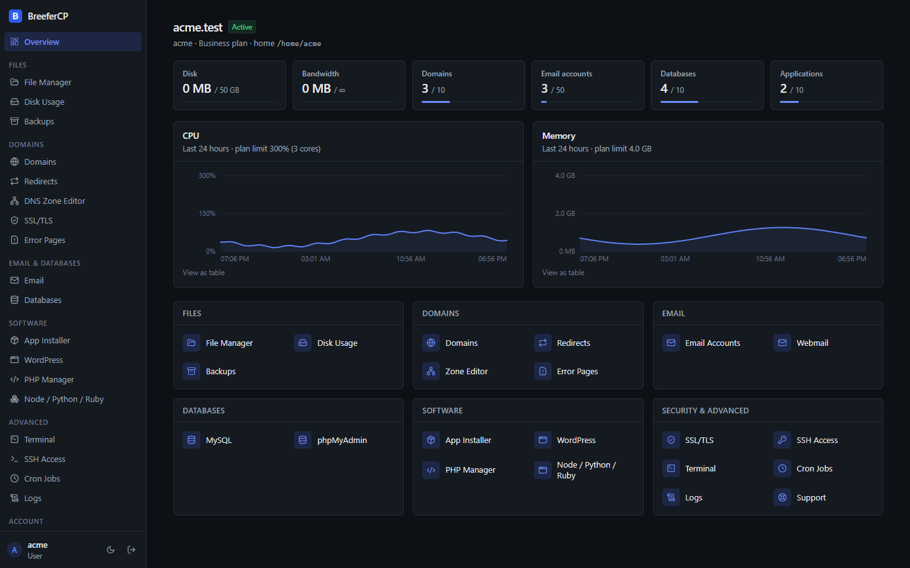

# BreeferCP

A free, open-source web hosting control panel. One panel for server administrators (the WHM role), resellers, and hosting customers (the cPanel role), built on a stack you can read end to end.

- **Backend:** Go. One static binary is the control plane, API, and provisioner.
- **Frontend:** React, TypeScript, Tailwind CSS. Light theme by default, dark theme optional.
- **Data:** SQLite for a single node, PostgreSQL for a cluster.
- **Hosting stack it drives:** nginx, PHP-FPM, MariaDB, Postfix + Dovecot, PowerDNS, OpenDKIM, nftables.
- **Isolation:** every account is a real Linux user with its own PHP-FPM pool and a systemd/cgroups v2 slice (CPU, memory, I/O, process limits). Node.js, Python and container apps run as hardened systemd services or Docker containers inside the same slice.
- **Billing:** a provisioning API plus ready-made modules for **WHMCS** and **Paymenter**.

License: [AGPL-3.0-or-later](LICENSE).

> **Status: early alpha (0.1).** The architecture, API, security model and UI are in place and covered by tests. The host-level provisioning code has been exercised in dry-run mode and by unit tests, but has **not yet been validated on a live server**. Do not put production customers on it yet. See [Project status](#project-status).

## Screenshots

| Administrator overview | Accounts |
|---|---|
|  |  |

| File manager | Dark theme |
|---|---|
|  |  |

| Email | DNS zone editor |
|---|---|
|  |  |

## Guides

- [Installation guide](docs/guide/installation.md)
- [Administrator guide](docs/guide/administrator-guide.md) (accounts, packages, resellers, firewall, audit)
- [Customer guide](docs/guide/customer-guide.md) (domains, SSL, files, databases, email, DNS, apps)
- [Connecting WHMCS or Paymenter](docs/guide/billing-setup.md)
- [Architecture](docs/architecture.md), [Security model](docs/security.md), [Billing API](docs/billing-api.md)

## What is in the box

| Area | Administrator / reseller | Customer |
|---|---|---|
| Accounts | Create, suspend, reactivate, terminate; change package; sign in as customer (one-time SSO) | Resource usage overview |
| Plans | Packages with disk, bandwidth, domain, database, mailbox, cron, app quotas and cgroup CPU/memory/I/O/process limits | |
| Web | | Domains (primary, addon, subdomain, alias), per-domain PHP version, force-HTTPS, nginx vhosts |
| TLS | | Let's Encrypt (HTTP-01, auto-renew) and custom certificates |
| Files | | Browser file manager: upload (drag and drop), edit, rename, copy, chmod, zip/unzip, download |
| Databases | | MariaDB databases, users and grants with an account-name prefix |
| Email | | Mailboxes with quotas, forwarders, catch-all, DKIM and DMARC publishing |
| DNS | | Zone editor backed by the PowerDNS API |
| Apps | | Node.js, Python and Docker applications with reverse-proxy to a domain |
| Automation | | Cron jobs, SSH keys, full or database-only backups with restore |
| Server | Service status and control, firewall (nftables), settings, audit log | |
| Resellers | Create resellers; each is fully isolated from other resellers | Reseller manages own customers and packages |
| Security | | Argon2id passwords, TOTP two-factor with recovery codes, session list, scoped API tokens |
| Billing | WHMCS module, Paymenter extension, generic idempotent REST API | |

## Architecture

```
 Browser (React SPA) ──┐
 WHMCS / Paymenter ────┼──► breeferd  (Go: REST API, auth, RBAC, audit)
 CLI / scripts ────────┘        │
                                ├─► store      SQLite or PostgreSQL
                                └─► provision  host changes, no shell, validated inputs
                                       ├─ useradd / systemd slices (cgroups v2)
                                       ├─ nginx vhosts · PHP-FPM pools
                                       ├─ MariaDB · PowerDNS (HTTP API)
                                       ├─ Postfix/Dovecot read mail tables straight from the panel database
                                       └─ nftables · Docker · cron · ACME
```

More detail in [docs/architecture.md](docs/architecture.md). The security model is in [docs/security.md](docs/security.md). The billing API is in [docs/billing-api.md](docs/billing-api.md).

## Quick start (development)

Requirements: Go 1.26+ (the file manager relies on `os.Root` methods added in 1.25) and Node 20+. Dry-run mode logs host commands instead of running them, so this works on any OS.

```bash
# 1. Build the UI
cd web && npm install && npm run build && cd ..

# 2. Create an admin and start the daemon in dry-run mode
export BREEFER_DRY_RUN=true BREEFER_LISTEN=127.0.0.1:2087 \
       BREEFER_DB_DSN=./dev.db BREEFER_DATA_DIR=./dev-data \
       BREEFER_WEB_DIR=./web/dist BREEFER_HOME_BASE=./dev-home
go run ./cmd/breeferd create-admin -config /dev/null -email you@example.com   # prints a password once
go run ./cmd/breeferd serve -config /dev/null
```

Open <http://127.0.0.1:2087>. For UI work, run `npm run dev` in `web/` (Vite proxies `/api` to the daemon).

```bash
make test        # Go tests (API, auth, provisioning, file jail) + UI type-check
make build       # linux/amd64 and linux/arm64 release tarballs in dist/
```

## Install on a server

On a fresh Debian 12+ or Ubuntu 22.04+ machine, from an extracted release tarball:

```bash
sudo ./deploy/install.sh --email you@example.com --hostname panel.example.com
```

The installer is for a **dedicated** server: it takes over nginx, Postfix, Dovecot and firewall configuration.

## Billing integrations

- **WHMCS:** copy [integrations/whmcs/modules/servers/breefercp](integrations/whmcs/modules/servers/breefercp) into your WHMCS `modules/servers/`. Create an API token with the `billing` scope, add a server of type *BreeferCP*, and put the token in *Access Hash*.
- **Paymenter:** copy [integrations/paymenter/BreeferCP](integrations/paymenter/BreeferCP) to `extensions/Servers/BreeferCP` and enable it.
- **Anything else:** call the REST API. Creation is idempotent on `external_ref`, so retried webhooks are safe. See [docs/billing-api.md](docs/billing-api.md).

## Project status

Working and tested: authentication (login, lockout, TOTP, sessions, CSRF, API tokens), RBAC and tenant isolation, the full account lifecycle, quotas, the file manager (including symlink and zip-slip resistance), configuration generators (nginx, PHP-FPM, systemd slices, nftables, cron, app units) with injection tests, SSO, the billing API, and the complete UI.

Not done yet, in rough priority order:

1. **Live-server validation** of every provisioner against real nginx, PHP-FPM, MariaDB, Postfix/Dovecot and PowerDNS (the installer has also not been run on a real host).
2. **Multi-node clusters:** the schema has `node_id` and PostgreSQL support, but the node agent and scheduler are not written yet.
3. Bandwidth accounting from nginx logs, backup destinations beyond local disk (S3/SFTP), scheduled backups.
4. Email: spam filtering, webmail, per-mailbox Sieve filters (the schema exists), autoresponders.
5. FTP/SFTP-only users, ModSecurity/WAF, malware scanning, one-click app installers, phpMyAdmin single sign-on, DNS clustering, DNSSEC toggle in the UI.
6. Translations, an OpenAPI document, and a public CLI.
7. A third-party security review before any production use.

## Contributing

Issues and pull requests are welcome. Please read [CONTRIBUTING.md](CONTRIBUTING.md) and, for vulnerabilities, [SECURITY.md](SECURITY.md).

## Credits

BreeferCP is created and maintained by **Shine Akhanda**. Portfolio: [shineakhanda.dev](https://shineakhanda.dev).

Thanks to everyone who files issues, sends patches, or tests on real servers. Contributors are listed on the [contributors page](https://github.com/BreeferCp/cpanel/graphs/contributors).
