# BreeferCP

A free, open-source web hosting control panel, built as two dedicated panels like cPanel & WHM:

- **WHM** on port **2087** for the server administrator, master resellers and resellers.
- **cPanel** on port **2083** for hosting customers.

Each panel has its own sign-in, session cookie and layout; a customer login is refused by WHM and an administrator login by cPanel. The whole stack can be read end to end.

- **Backend:** Go. One static binary is the control plane, API, provisioner and metrics collector.
- **Frontend:** React, TypeScript, Tailwind CSS. Light theme by default, dark theme optional.
- **Data:** SQLite for a single node, PostgreSQL for a cluster.
- **Hosting stack it drives:** nginx **or OpenLiteSpeed**, PHP-FPM (multi-version), MariaDB, Postfix + Dovecot, PowerDNS, OpenDKIM, nftables, phpMyAdmin, Roundcube, WP-CLI.
- **Isolation:** every account is a real Linux user with its own PHP pool and a systemd/cgroups v2 slice (CPU, memory, I/O, processes), plus a filesystem quota. Node.js, Python, Ruby and Docker apps run inside the same slice.
- **Billing:** a provisioning API plus ready-made modules for **WHMCS** and **Paymenter**.

License: [AGPL-3.0-or-later](LICENSE).

> **Status: alpha (0.3).** Everything below is implemented and covered by automated tests. A browser crawler exercises it end to end in dry-run mode: both panels, every role, both themes, desktop and mobile. The host-level provisioning has **not yet been validated on a live server**, so do not put production customers on it yet. See [Project status](#project-status).

## Screenshots

| WHM home | cPanel home |
|---|---|
|  | 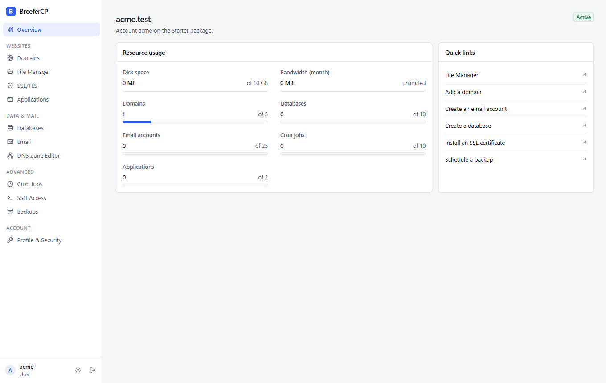 |

| WordPress toolkit: security check | WordPress toolkit: staging and clone |
|---|---|
| 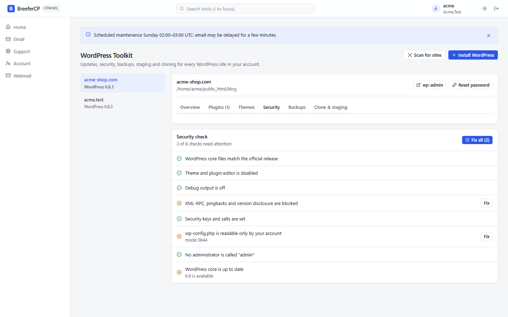 | 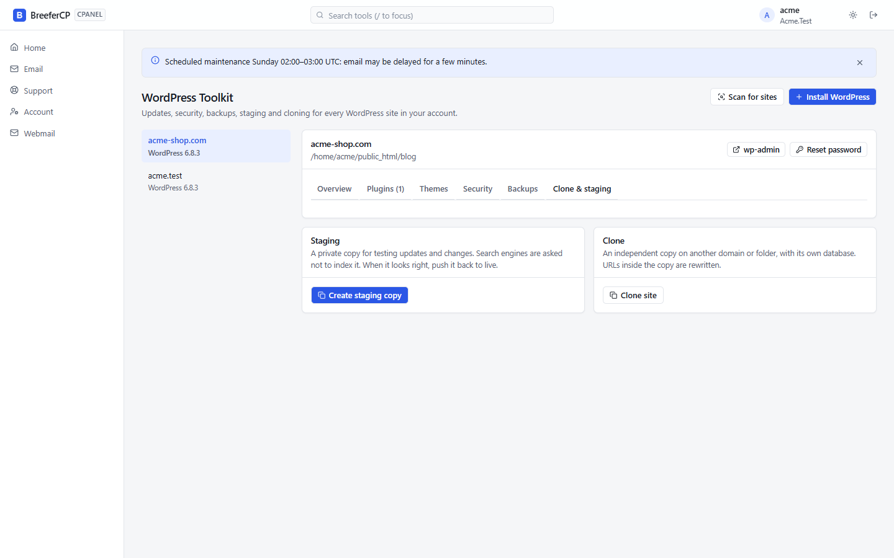 |

| Feature Manager | Updates |
|---|---|
| 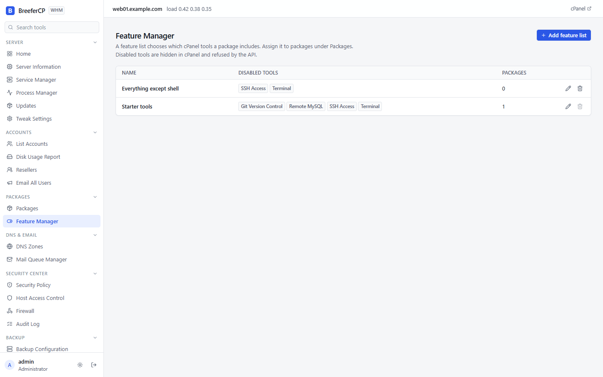 | 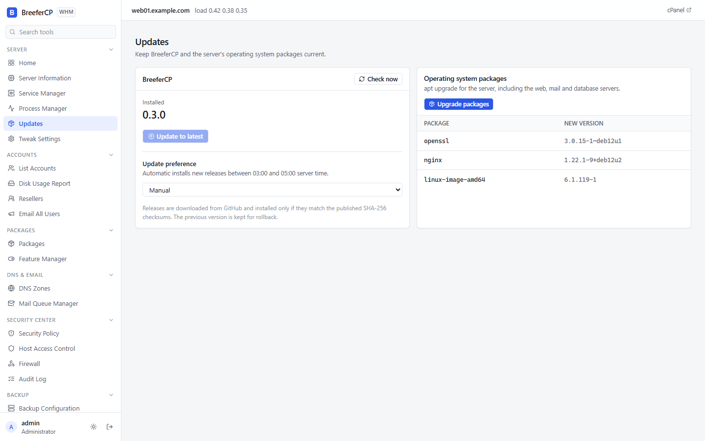 |

| Host Access Control | Mail Queue Manager |
|---|---|
| 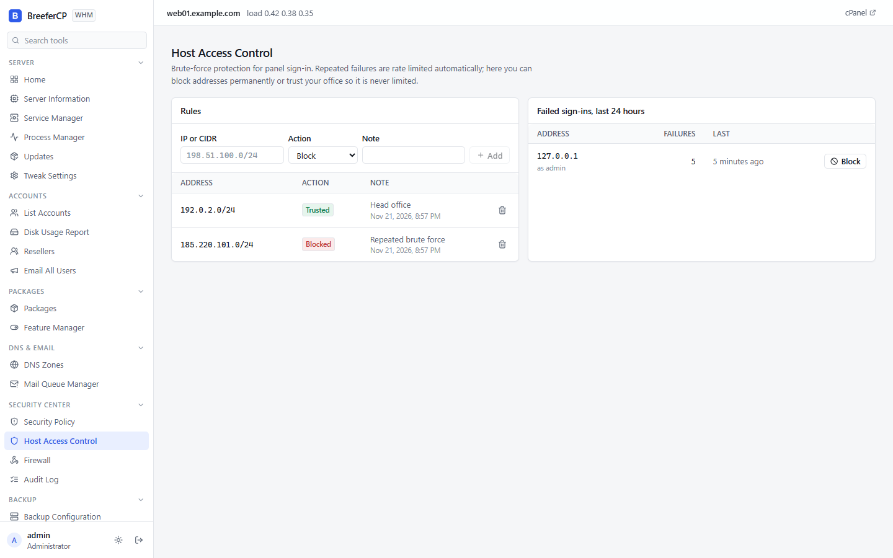 | 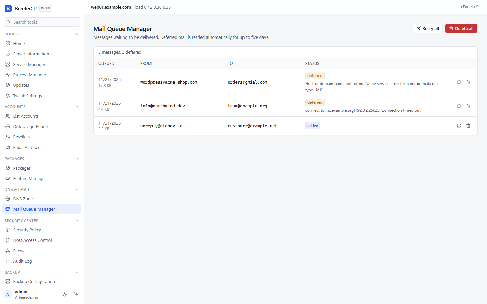 |

| FTP accounts | Spam filters |
|---|---|
| 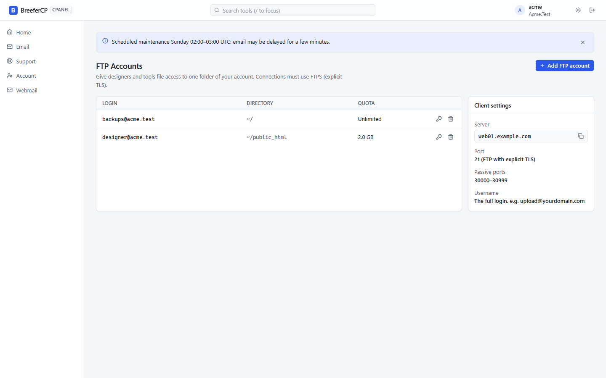 | 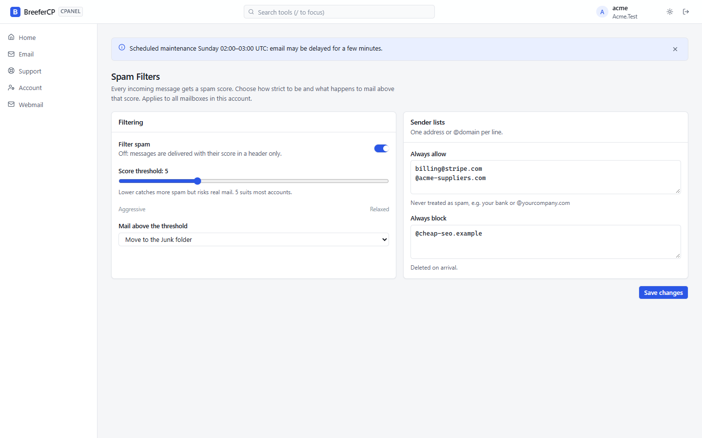 |

| File manager | Dark theme |
|---|---|
| 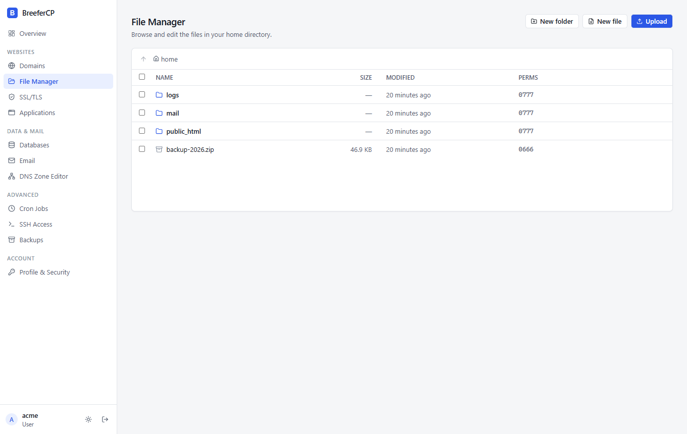 | 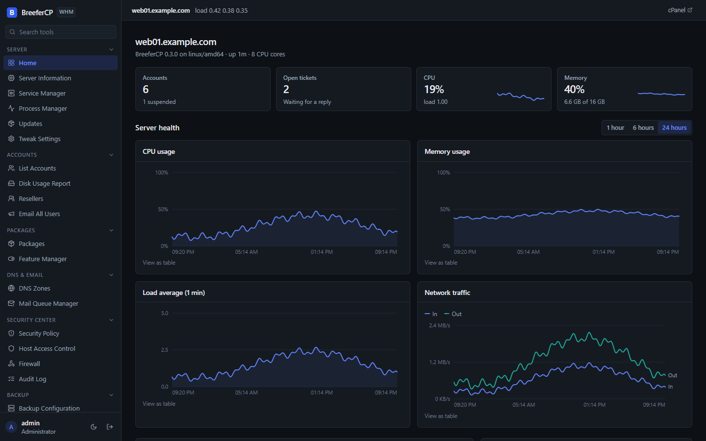 |

| WHM sign-in | cPanel sign-in |
|---|---|
|  |  |

More in [docs/images](docs/images).

## Guides

- [Installation guide](docs/guide/installation.md)
- [Administrator guide](docs/guide/administrator-guide.md): accounts, packages, resellers, shell access, firewall, nameservers, metrics
- [Customer guide](docs/guide/customer-guide.md): every customer feature, step by step
- [Connecting WHMCS or Paymenter](docs/guide/billing-setup.md)
- [Architecture](docs/architecture.md), [Security model](docs/security.md), [Billing API](docs/billing-api.md)

## Features

### Server administrator (WHM)

| Area | What you get |
|---|---|
| Home | Live CPU, memory, load and network charts (1h, 6h, 24h), top accounts by resource use, open tickets, capacity; searchable, collapsible tool menu |
| Account information | **List Accounts**, **List Suspended Accounts**, **List Domains** (every domain with owner, PHP and certificate status), **Disk and Bandwidth Usage** |
| Account functions | Separate pages, each with search, sorting and bulk actions: **Create a New Account** (with package preview), **Modify an Account**, **Manage Account Suspension**, **Upgrade/Downgrade**, **Password Modification**, **Terminate Accounts** (typed confirmation); sign in to the customer's cPanel |
| Packages | **Add / Edit / Duplicate a Package** on their own pages: disk, bandwidth, domain, database, mailbox, cron, app and FTP quotas; CPU, memory, I/O and process limits (cgroups v2); PHP versions; shell access |
| **Feature Manager** | Feature lists that switch cPanel tools on or off per package, enforced by the API as well as hidden in the UI |
| Resellers | Resellers and **master resellers** (who create resellers), each with account, disk and sub-reseller allocation limits |
| Server | **Basic WebHost Manager Setup**, **Server Time** (time zone, NTP sync), **Change Root Password** (re-authenticated), **Server Information**, Service Status, **Process Manager**, **Reboot** (graceful or forceful), nameservers with automatic glue records |
| Software & SSL | **MultiPHP Manager** (bulk PHP version changes across accounts), **Manage AutoSSL** (certificate status of every domain, run AutoSSL now) |
| **Updates** | One-click panel updates from GitHub releases verified against SHA-256 checksums, automatic or manual, with rollback; OS package upgrades |
| DNS & email | **DNS Zones** across all accounts (with DNSSEC status), **Mail Queue Manager** (retry, delete, flush) |
| Security Center | **Security Advisor** (ranked findings with a link to the fix), **SSH Settings** (password auth, root login, port; validated with `sshd -t`), **Manage root's SSH Keys**, **Security Policy** (require 2FA for admins or everyone, WHM IP allow list), **Host Access Control** (cPHulk-style block and trust lists with a failed-login report), nftables firewall, audit log |
| Backup | **Backup Configuration** (daily or weekly backups of every account with retention), **Backup Restoration** across all accounts |
| Support | Ticket desk; **Email All Users** with an optional cPanel announcement banner |
| Web server | nginx (default) or OpenLiteSpeed with `.htaccess` support and per-account LSAPI |

### Customer (cPanel)

| Area | What you get |
|---|---|
| Home | Tool groups with instant search (press `/`), general information, usage statistics, 24-hour CPU and memory charts, provider announcements |
| Files | File manager (upload, edit, rename, copy, chmod, zip/unzip, download), disk usage, **FTP accounts** (FTPS, chrooted, per-account quota), backups with restore, **Git version control** (clone, pull, push over SSH) |
| Domains | Domains, **Subdomains**, **Aliases**, redirects (301/302/307/308), DNS zone editor with **DNSSEC**, **Dynamic DNS** (dyndns-compatible update URL), SSL (Let's Encrypt or own certificate) |
| Email | **Email Accounts** (quota, suspend, connect devices, bulk actions), **Forwarders** and **domain forwarders**, **Email Routing** (local or remote MX), **Default Address** (catch-all), **Mailing Lists** (distribution lists), **Email Filters** (global and per account, ordered, with a filter tester), **Track Delivery** (Postfix log search), **Email Deliverability** (SPF, DKIM, DMARC, MX and reverse DNS checks with one-click repair), **autoresponders**, **spam filters**, **Address Importer** (CSV), **Email Disk Usage**, webmail |
| Databases | MariaDB databases, users and grants, **Database Wizard**, check and repair tables, phpMyAdmin single sign-on, **Remote MySQL** hosts |
| Metrics | **Visitors** (latest hits, top pages, visitors and referrers), **Errors**, **Bandwidth** per domain per day, **Raw Access** log downloads, **Resource Usage** (CPU, memory, processes vs. limits) |
| Software | One-click app installer (WordPress, Drupal, Nextcloud, Matomo, Grav, DokuWiki, Laravel); **WordPress Toolkit** (see below); **MultiPHP Manager** and **MultiPHP INI Editor**; **Optimize Website** (gzip); Node.js, Python and Ruby apps; Docker |
| Security | SSL/TLS, **Directory Privacy** (password-protected folders), **IP Blocker**, **Hotlink Protection**, SSH keys |
| Advanced | Browser terminal, cron jobs, **Track DNS** (lookup and traceroute), **Indexes** (directory listings), custom error pages, **MIME Types** |
| Preferences | Password & Security, **Two-Factor Authentication**, **Manage API Tokens**, **Contact Information** (disk and bandwidth warning emails), support tickets |

### WordPress Toolkit

Modelled on WP Toolkit and Softaculous, using WP-CLI as the account user:

- **Scan** the account for WordPress sites installed by hand and add them.
- **Smart updates:** core (minor or all releases), plugins and themes nightly or on demand. Each run backs up first, checks the home page afterwards, and **rolls back automatically** if the site broke.
- **Security check** with one-click fixes: core checksum verification, file editor off, debug off, XML-RPC and pingbacks blocked, salts, `wp-config.php` permissions, no `admin` user, pending updates.
- **Backups** of files and database with restore (a safety backup is taken before every restore).
- **Staging and clone:** copy a site to another domain or folder with its own database and rewritten URLs; **push staging to live** keeps the live database credentials and backs up the live site first.
- Plugins and themes: install from wordpress.org by slug, update, activate, delete. Maintenance mode, search-engine indexing, debug mode, password reset.

## Architecture

```
 Browser (React SPA) ──┐
 WHMCS / Paymenter ────┼──► breeferd  (Go: REST API, auth, RBAC, audit, metrics)
 CLI / scripts ────────┘        │
                                ├─► store      SQLite or PostgreSQL
                                └─► provision  host changes, no shell, validated inputs
                                       ├─ useradd · systemd slices (cgroups v2) · quotas · sshd groups
                                       ├─ nginx or OpenLiteSpeed vhosts · PHP-FPM pools
                                       ├─ MariaDB · PowerDNS (HTTP API) · WP-CLI · Composer
                                       ├─ Postfix/Dovecot read the panel database directly
                                       └─ nftables · Docker · cron · ACME · PTY terminal
```

Details in [docs/architecture.md](docs/architecture.md) and [docs/security.md](docs/security.md).

## Quick start (development)

Requirements: Go 1.26+ and Node 20+. Dry-run mode logs host commands instead of running them, so this works on any OS.

```bash
cd web && npm install && npm run build && cd ..
export BREEFER_DRY_RUN=true BREEFER_LISTEN=127.0.0.1:2087 \
       BREEFER_DB_DSN=./dev.db BREEFER_DATA_DIR=./dev-data \
       BREEFER_WEB_DIR=./web/dist BREEFER_HOME_BASE=./dev-home
export BREEFER_CPANEL_LISTEN=127.0.0.1:2083
go run ./cmd/breeferd create-admin -config /dev/null -email you@example.com   # prints a password once
go run ./cmd/breeferd serve -config /dev/null
```

Open WHM at <http://127.0.0.1:2087> and cPanel at <http://127.0.0.1:2083>. In dry-run mode the charts show labelled demo data. For UI work run `npm run dev` in `web/`.

```bash
make test        # Go tests (API, auth, provisioning, file jail) + UI type-check
make build       # linux/amd64 and linux/arm64 release tarballs in dist/
```

## Install on a server

On a fresh Debian 12+ or Ubuntu 22.04+ machine, from an extracted release tarball:

```bash
sudo ./deploy/install.sh --email you@example.com --hostname panel.example.com
```

The installer is for a **dedicated** server: it takes over nginx, Postfix, Dovecot, Rspamd, Pure-FTPd, SSH access groups and firewall configuration.

Updating later: **WHM → Updates**, or `sudo breeferd update` from a shell (`-check` to only look, `-rollback` to go back).

## Billing integrations

- **WHMCS:** copy [integrations/whmcs/modules/servers/breefercp](integrations/whmcs/modules/servers/breefercp) into WHMCS `modules/servers/`, create an API token with the `billing` scope and put it in the server's *Access Hash*.
- **Paymenter:** copy [integrations/paymenter/BreeferCP](integrations/paymenter/BreeferCP) to `extensions/Servers/BreeferCP`.
- **Anything else:** the REST API is idempotent on `external_ref`. See [docs/billing-api.md](docs/billing-api.md).

## Project status

Working and tested:

- Authentication: lockout, TOTP, sessions, CSRF, API tokens, SSO, 2FA policy, host access rules and the WHM IP allow list.
- Panel separation, where each panel refuses the other's users and cookies.
- The four-level tenant hierarchy and reseller allocation limits.
- Feature lists, enforced server side.
- The account lifecycle, quotas and shell access control.
- The file manager, resistant to symlink and zip-slip attacks.
- Config generators for nginx (including directory privacy, IP blocks, hotlink rules, directory indexes, MIME types and compression), OpenLiteSpeed, PHP-FPM, systemd, nftables, cron, app units, Sieve and Pure-FTPd, all with injection tests.
- SHA-512 crypt against the reference vectors.
- The self-updater (checksum mismatch and path traversal tests).
- The WordPress toolkit, tickets, metrics, the billing API and the full UI.

Not done yet:

1. **Live-server validation** of every provisioner and of the installer on real Debian and Ubuntu hosts. OpenLiteSpeed support is the least proven. Mail filtering (Rspamd and Sieve, including the new email filters), mailing lists, domain forwarders and email routing (Postfix SQLite maps), FTP, DNSSEC, SSH settings and the WordPress toolkit's clone, push and restore commands have unit tests for their generated configuration and commands, but have not run against real services yet.
2. **Multi-node clusters:** PostgreSQL and `node_id` exist, but the node agent and scheduler are not written.
3. **Account transfer** from cPanel (`cpmove` import) and other panels. Off-site backup targets (S3/SFTP). Monthly bandwidth accounting from web logs (so bandwidth limits and warning emails do not work yet).
4. Virus scanning (ClamAV), ModSecurity/WAF, Leech Protection, IP address manager, EasyApache-style module management, mailing-list archives and subscription pages (lists are distribution lists only), sub-users (cPanel User Manager), notification emails other than disk and bandwidth.
5. Translations and an OpenAPI document.
6. An independent security review before production use.

## Contributing

Issues and pull requests are welcome. Please read [CONTRIBUTING.md](CONTRIBUTING.md) and, for vulnerabilities, [SECURITY.md](SECURITY.md).

## Credits

BreeferCP is created and maintained by **Shine Akhanda**. Portfolio: [shineakhanda.dev](https://shineakhanda.dev).

Thanks to everyone who files issues, sends patches, or tests on real servers. Contributors are listed on the [contributors page](https://github.com/BreeferCp/cpanel/graphs/contributors).
