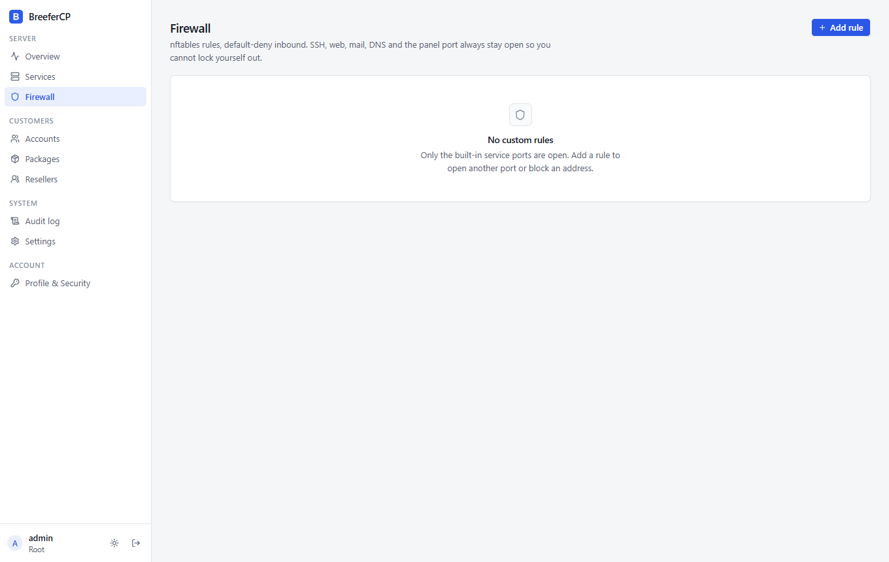

# Administrator guide (WHM role)

Administrators and resellers manage customers; the **root** role also manages the server. Resellers see only their own customers and packages, never other resellers' or any server settings.

## Packages

A package is a plan assigned to accounts. A quota of `0` means unlimited.

| Setting | Effect |
|---|---|
| Disk, bandwidth | Quotas shown to the customer and sent to billing |
| Domains, databases, mailboxes, cron jobs, applications | Hard limits; creating more fails with *limit reached* |
| CPU % | systemd `CPUQuota` for the account (100 = one core) |
| Memory | `MemoryMax`; the account's processes are OOM-killed above it |
| I/O weight | cgroup `IOWeight` relative to other accounts |
| Max processes | `TasksMax`; also sizes the PHP-FPM pool |
| PHP versions | Versions the customer may select; the first is the default |
| Shell access | Allows SSH shell for the account |

Editing a package re-applies the limits to every active account on it immediately.

## Accounts

Creating an account provisions, in order: panel login, Linux user and home (`0700`), resource slice, PHP-FPM pool, nginx vhost, and a DNS zone. If any host step fails, everything is rolled back.

From the **⋯** menu on an account:

- **Sign in as customer** opens their panel in a new tab using a 60-second single-use token.
- **Suspend** takes sites and mail offline, kills their processes, locks the Linux user and signs the customer out. Data is kept. The reason is shown to the customer.
- **Reactivate** reverses a suspension.
- **Terminate** permanently deletes the user, files, databases, mailboxes and DNS zones.

Click an account's domain to open its hosting pages (files, domains, email, databases and so on) exactly as the customer sees them.

## Resellers (root only)

**Resellers → Create reseller.** A reseller creates their own packages and customers. Every query is scoped to the reseller, and cross-tenant requests return *not found*.

## Services (root only)

Status, start, stop and restart for nginx, PHP-FPM, MariaDB, Postfix, Dovecot, PowerDNS, OpenDKIM, Docker, nftables, fail2ban and the panel itself (the panel cannot be stopped from the panel).

## Firewall (root only)

The firewall is default-deny inbound. SSH, web, mail, DNS and the panel port are always open so you cannot lock yourself out. Add rules for other ports or to block an address. Each change is validated with `nft -c` before it replaces the live ruleset.

## Audit log (root only)

Every sign-in (successful and failed), account change, file write, DNS edit, token and 2FA change is recorded with actor, target and IP. Entries are kept for one year.

## Settings (root only)

Server IP (used in new DNS zones), hostname, nameservers, contact and Let's Encrypt email.

## Your own security

- Turn on two-factor authentication under **Profile & Security** and store the recovery codes offline.
- Review **Sessions** and sign out devices you do not recognise.
- Create **API tokens** with the narrowest scope and an IP allow-list.
