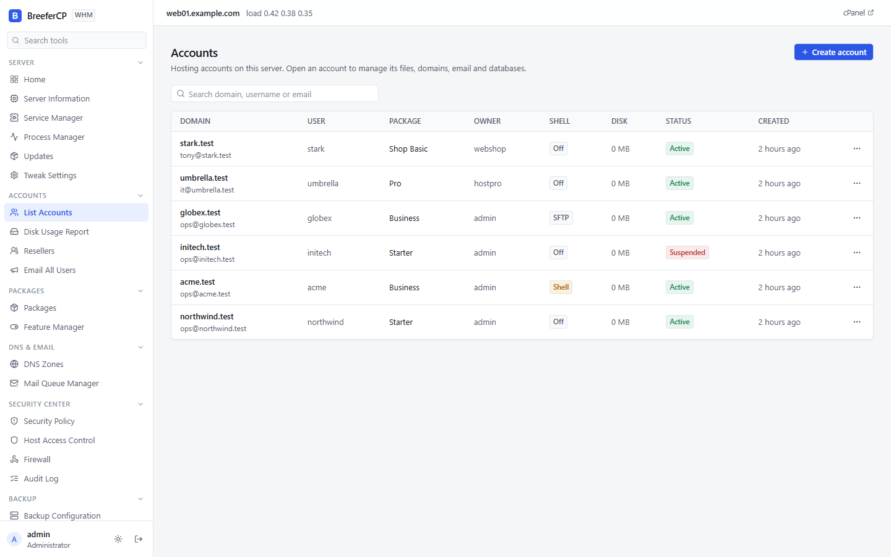
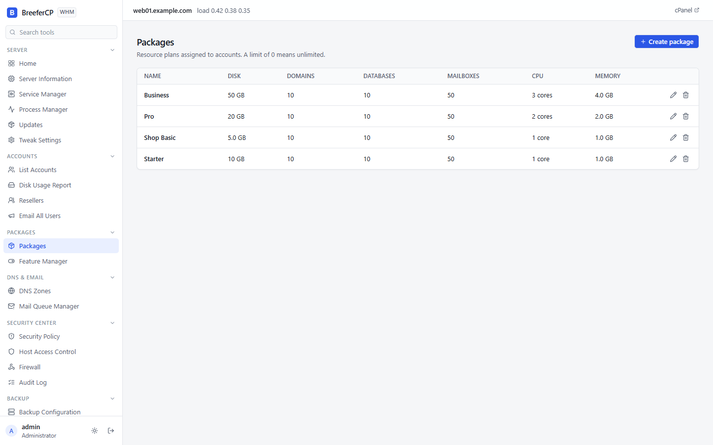
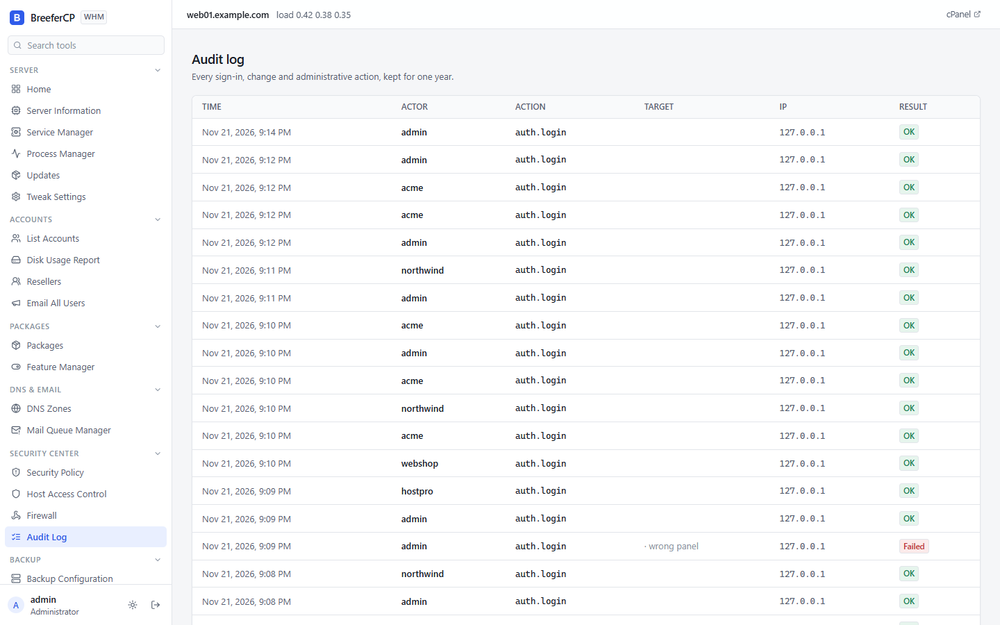
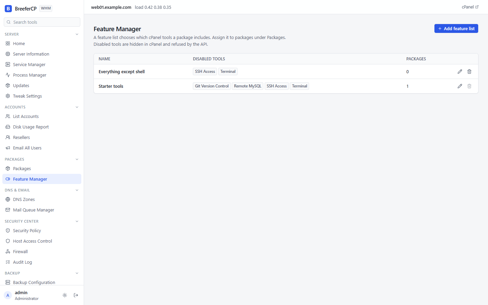
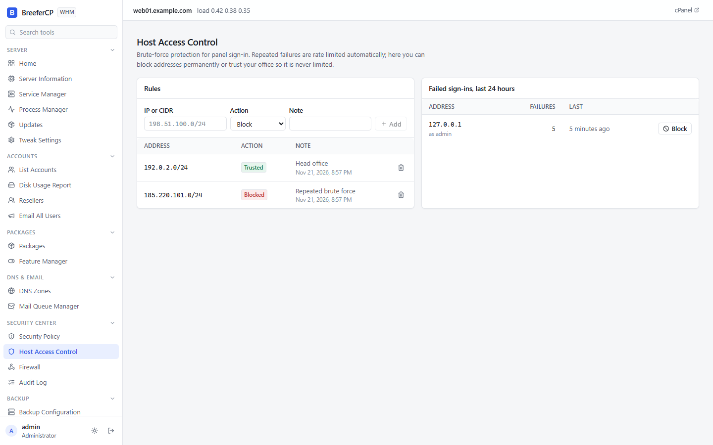
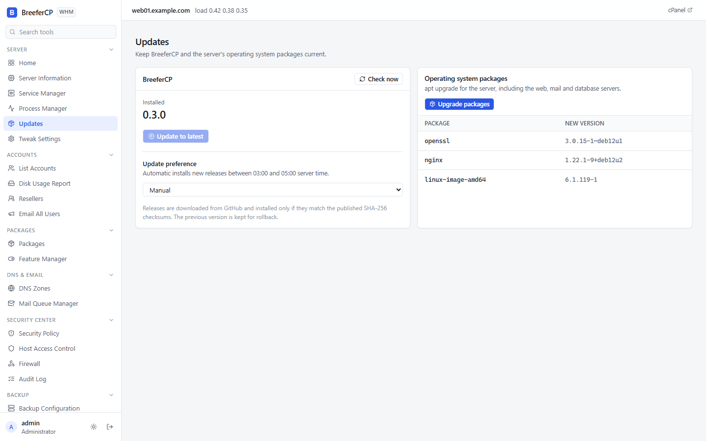

# Administrator guide (WHM role)

Administrators and resellers manage customers; the **root** role also manages the server. Resellers see only their own customers and packages, never other resellers' or any server settings.

## Packages

A package is a plan assigned to accounts. A quota of `0` means unlimited.

| Setting | Effect |
|---|---|
| Disk, bandwidth | Quotas shown to the customer and sent to billing |
| Domains, databases, mailboxes, cron jobs, applications | Hard limits; creating more fails with *limit reached* |
| CPU % | systemd `CPUQuota` for the account (100 = one core) |
| Memory | `MemoryMax`; the account's processes are OOM-killed above it |
| I/O weight | cgroup `IOWeight` relative to other accounts |
| Max processes | `TasksMax`; also sizes the PHP-FPM pool |
| PHP versions | Versions the customer may select; the first is the default |
| Shell access | Allows SSH shell for the account |

Editing a package re-applies the limits to every active account on it immediately.

## Accounts

Creating an account provisions, in order: panel login, Linux user and home (`0700`), resource slice, PHP-FPM pool, nginx vhost, and a DNS zone. If any host step fails, everything is rolled back.

From the **⋯** menu on an account:

- **Sign in as customer** opens their panel in a new tab using a 60-second single-use token.
- **Suspend** takes sites and mail offline, kills their processes, locks the Linux user and signs the customer out. Data is kept. The reason is shown to the customer.
- **Reactivate** reverses a suspension.
- **Terminate** permanently deletes the user, files, databases, mailboxes and DNS zones.

Click an account's domain to open its hosting pages (files, domains, email, databases and so on) exactly as the customer sees them.

## Resellers (root only)

**Resellers → Create reseller.** A reseller creates their own packages and customers. Every query is scoped to the reseller, and cross-tenant requests return *not found*.

## Services (root only)

Status, start, stop and restart for nginx, PHP-FPM, MariaDB, Postfix, Dovecot, PowerDNS, OpenDKIM, Docker, nftables, fail2ban and the panel itself (the panel cannot be stopped from the panel).

## Firewall (root only)

The firewall is default-deny inbound. SSH, web, mail, DNS and the panel port are always open so you cannot lock yourself out. Add rules for other ports or to block an address. Each change is validated with `nft -c` before it replaces the live ruleset.

## Audit log (root only)

Every sign-in (successful and failed), account change, file write, DNS edit, token and 2FA change is recorded with actor, target and IP. Entries are kept for one year.

## Settings (root only)

Server IP (used in new DNS zones), hostname, nameservers, contact and Let's Encrypt email.

## Your own security

- Turn on two-factor authentication under **Profile & Security** and store the recovery codes offline.
- Review **Sessions** and sign out devices you do not recognise.
- Create **API tokens** with the narrowest scope and an IP allow-list.

## Dashboard and metrics

The overview charts CPU, memory, load and network traffic for the last 1, 6 or 24 hours (sampled every 30 seconds), and lists the accounts using the most CPU over the last hour. Every chart has a **View as table** link. Per-account CPU, memory and process counts are read from each account's cgroup every 5 minutes and kept for 7 days; customers see their own on their home page.

## Master resellers and reseller limits

Hierarchy: root → master reseller → reseller → customers. A master reseller can also own customers directly.

| Limit | Effect |
|---|---|
| Max accounts | Account creation fails with *limit reached* once the reseller owns this many |
| Disk to allocate | The sum of the disk limits of the reseller's accounts' packages may not exceed this; such resellers must use packages with a disk limit |
| Max sub-resellers | Master resellers only: how many resellers they may create |

Only root can make a reseller a master. Suspending a reseller signs it out and revokes its API tokens; its customers keep running. A reseller can only be deleted once it has no accounts or sub-resellers.

## Shell access

Set per account under **Accounts → ⋯ → Modify account**:

- **Disabled:** no SSH login (`/usr/sbin/nologin`).
- **SFTP only:** the user joins `breefer-sftp`; sshd forces `internal-sftp`, so no shell, TTY or tunnels.
- **Full shell:** `/bin/bash` over SSH and the browser **Terminal**, both inside the account's cgroup limits. Only available when the account's package allows shell access.

## Nameservers

Under **Settings → Nameservers** set `ns1`/`ns2` host names and IPs. New DNS zones use them as NS records, and if the parent domain (for example `example.com` for `ns1.example.com`) is hosted on this server, the glue A records are published automatically.

## Support tickets

Customers' tickets go to whoever owns the customer (their reseller, or root). Replying marks a ticket *Answered*; a customer reply marks it *Customer reply*. Resellers can open tickets with their own provider from the same page.

## WHM and cPanel are separate panels

WHM runs on port 2087 and cPanel on port 2083. Administrators and resellers sign in to WHM only; hosting customers sign in to cPanel only. Signing in on the wrong one shows a link to the right one. The left menu of WHM is searchable and grouped like WHM's own (Server, Accounts, Packages, DNS & Email, Security Center, Backup, Support).

## Feature Manager

A **feature list** names the cPanel tools a package does *not* include, for example a "Starter" list without Terminal, Git and Remote MySQL. Create lists under **Packages → Feature Manager**, then choose one in each package's **Feature list** field. Disabled tools disappear from the customer's cPanel and the API refuses them (`feature_disabled`), so they cannot be reached by URL either. When you manage an account from WHM you always see every tool. A list that packages still use cannot be deleted.

## Server tools (root)

- **Server Information:** operating system, kernel, CPU, uptime, load, cgroup version, memory and every mounted filesystem.
- **Process Manager:** all processes by memory use, filterable by user or command. Stop sends SIGTERM, with SIGKILL as an option. PID 1 and the panel itself are protected.
- **Mail Queue Manager:** the Postfix queue with the reason each message is deferred. Retry or delete one message, retry everything, or empty the queue.
- **DNS Zones:** every zone on the server with its account and DNSSEC state; *Edit zone* opens the account's Zone Editor.
- **Disk Usage Report:** accounts by disk use against quota, with a filter for those at 90% or over.

## Security Center (root)

- **Security Policy:** require two-factor authentication for administrators and resellers, or for everyone. A user without 2FA can still sign in but can only open their profile until they turn it on. You must have 2FA yourself before enabling the policy. **WHM access by IP** limits WHM, not cPanel, to a list of addresses or ranges; the list must include the address you are using.
- **Host Access Control:** brute-force protection for sign-in. Failed sign-ins are rate limited automatically. **Block** refuses an address or range outright; **Trust** exempts your office or monitoring from rate limiting. The right-hand table lists the last 24 hours of failed sign-ins by address, with a one-click Block.

## Backup Configuration (root)

Back up every active account daily or weekly at a chosen hour, with files, email and databases (or a subset), keeping the newest *N* scheduled backups per account. Customers see and restore them on their **Backups** page. Backups are stored on the server; copy `/var/lib/breefercp/backups` off-site.

## Email All Users

Write to all your customers (resellers: your own customers; root can also write to resellers or everyone). Root can also publish the subject as an **announcement** shown at the top of every cPanel until the customer dismisses it.

## Updates (root)

See [Installation → Updating](installation.md#updating). Panel updates are verified against the release checksums and can be rolled back. Operating system packages can be upgraded from the same page.
