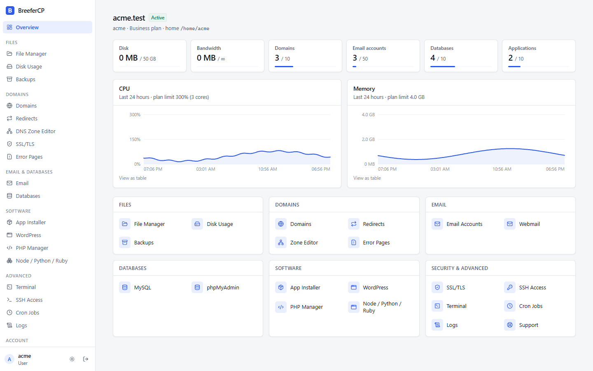
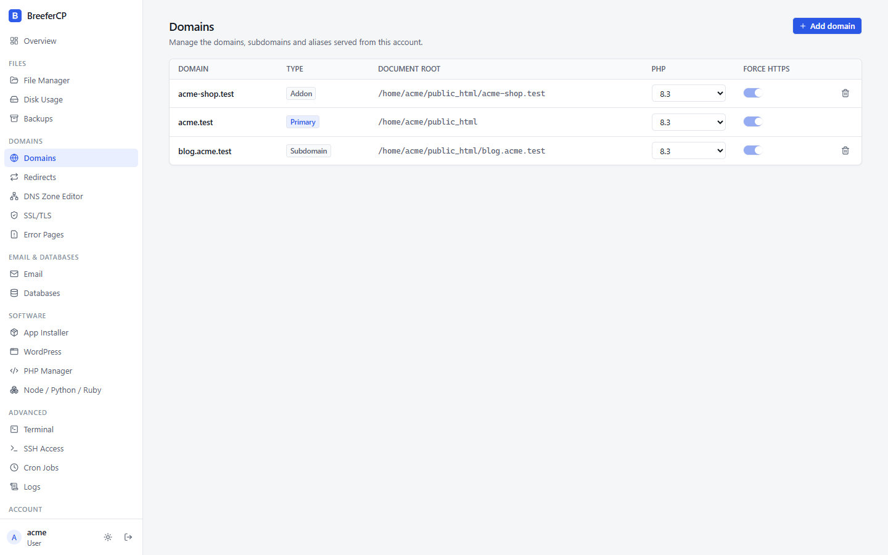
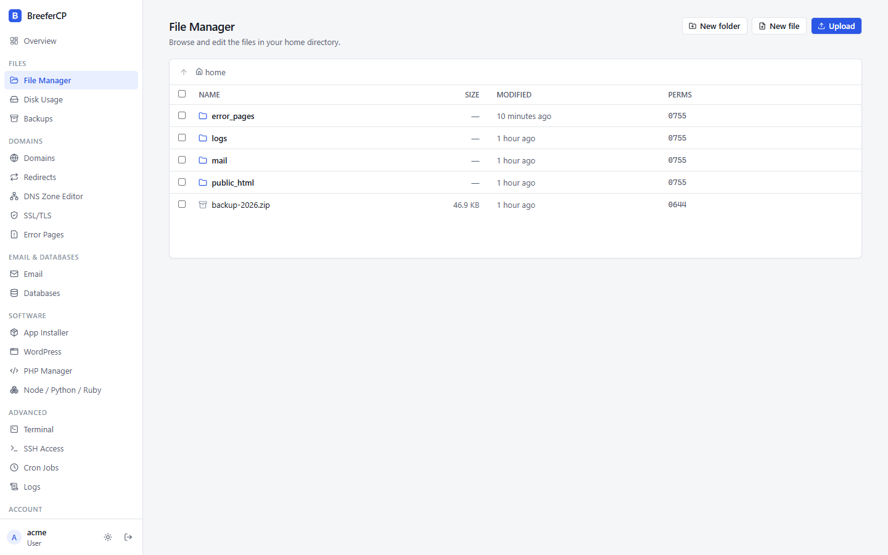
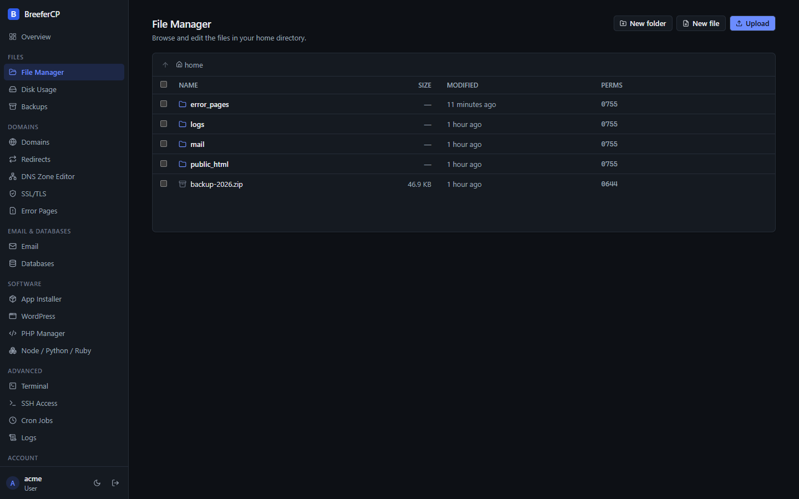
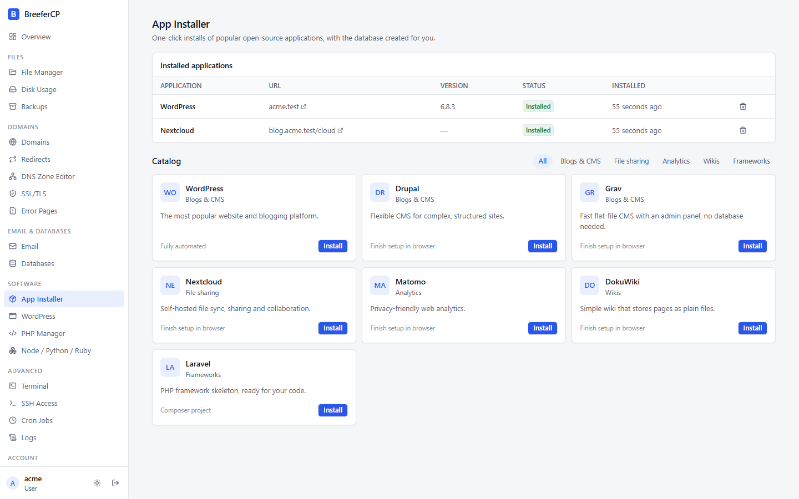
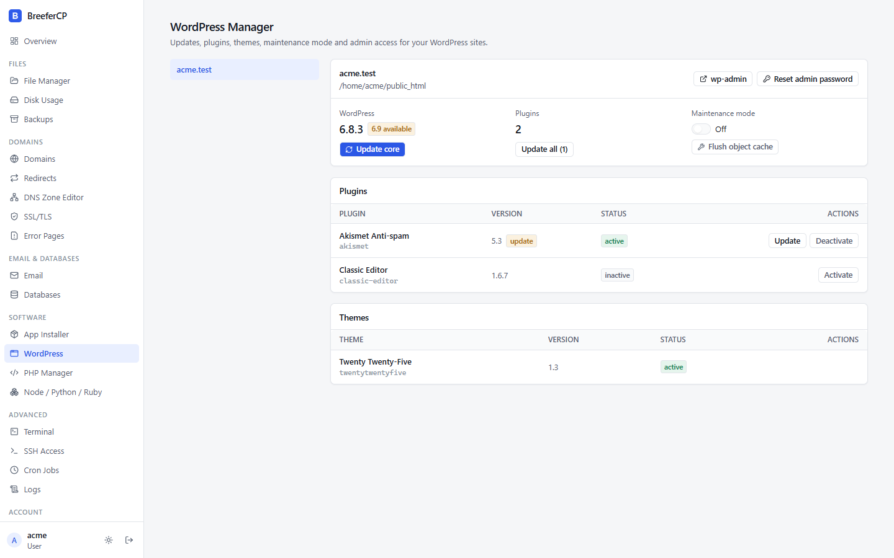
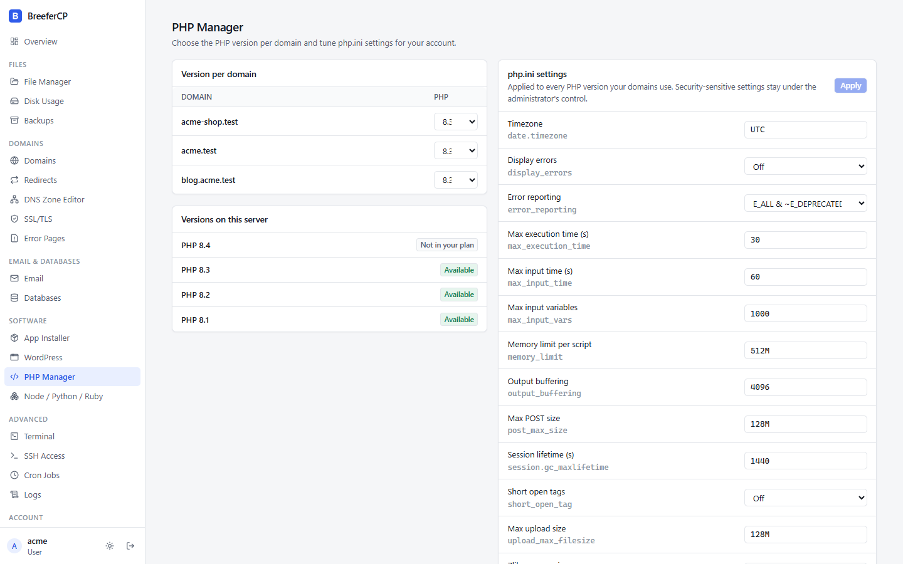

# Customer guide (cPanel role)

The **Overview** shows your plan, status and how much of each quota you have used.

## Domains

Add an **addon domain** (a separate site), a **subdomain**, or an **alias** (same content on another name). Choose the PHP version per domain. **Force HTTPS** turns on once the domain has a certificate. The primary domain cannot be removed.

## SSL/TLS

Click **Get free certificate** to issue a Let's Encrypt certificate for the domain and its `www` name. It renews automatically. The domain must already point at this server. To use your own certificate, choose **Upload** and paste the certificate chain and key; the panel checks that they match and cover the domain.

## File Manager

- Drag files onto the list or use **Upload**.
- Click a file to edit it (text files up to 5 MB; **Ctrl+S** saves). Click a folder to open it.
- Hover a row for rename, copy, permissions, download and delete. Select several rows to compress them to a zip or delete them together. Click a `.zip` to extract it here.
- You can only reach your own home directory. Your site files go in `public_html`.

## Databases

Create a database, create a user, then use **Add user to database**. Names are prefixed with your account name (`acme_shop`). Connect from your site with host `localhost`.

## Email

Create mailboxes with a quota, forwarders (use `*` as the name for a catch-all), and enable **DKIM** on the Deliverability tab, which also publishes a DMARC record. Mail clients: IMAP `mail.<yourdomain>` port 993 (SSL), SMTP port 587 (STARTTLS) or 465 (SSL), username is the full address.

## DNS Zone Editor

Add, replace or delete A, AAAA, CNAME, MX, TXT, NS, SRV and CAA records. Saving a record with the same name and type replaces the existing one. SOA records are managed by the server.

## Applications

Run Node.js, Python 3 or a Docker image. Put your code in `apps/<name>`, give a start command (the `PORT` environment variable is set for you) and optionally attach a domain; the panel proxies it for you. Applications run inside your account's CPU and memory limits.

## Cron jobs, SSH keys, backups

- **Cron jobs** run as your user on a schedule (pick a preset or write the five-field expression).
- **SSH access:** authorize a public key; connect with `ssh <user>@<yourdomain>` (shell access depends on your plan).
- **Backups:** create a full or databases-only backup and restore files from it later. Backups run in the background.

## Keep your account safe

Under **Profile & Security** change your password, enable two-factor authentication, and sign out other sessions.

## Dark theme

Use the sun/moon button next to your name in the sidebar to switch between light, dark and system.

## App Installer

Pick an application, a domain and (optionally) a folder. A database and database user are created for you within your plan's limits.

- **WordPress** is installed fully automatically: enter a site title and admin account.
- **Drupal, Nextcloud, Matomo, Grav, DokuWiki** are downloaded from the official source; open the site afterwards to finish the setup wizard. The database name is shown under *Installed applications* and in **Databases**.
- **Laravel** creates a Composer project; point the domain's document root at its `public` folder.

## WordPress Manager

For every WordPress site: update WordPress core, update plugins and themes (one by one or all), activate or deactivate plugins, switch maintenance mode, flush the object cache, and reset any user's password without email.

## PHP Manager

Choose the PHP version per domain from the versions your plan allows, and change common `php.ini` settings (memory limit, upload size, execution time, display errors, timezone and more). Security settings such as `disable_functions` and `open_basedir` stay with your provider.

## Redirects and error pages

- **Redirects:** send an exact path (for example `/old-page`) to any URL, permanently (301/308) or temporarily (302/307).
- **Error Pages:** write your own HTML for 400, 401, 403, 404, 500, 502 and 503 errors. A starter template is filled in for you; **Restore default** switches back.

## phpMyAdmin and webmail

- In **Databases**, click **phpMyAdmin**. You are signed in automatically with a temporary login that can see only your databases.
- In **Email → Webmail & clients**, open Roundcube or copy the IMAP/POP3/SMTP settings for your mail app.

## Terminal

If your plan includes shell access and your provider enabled it, **Terminal** opens a shell on the server as your user. Sessions close after 30 minutes idle or 4 hours.

## Disk usage and logs

**Disk Usage** shows which folders and databases use the most space. **Logs** shows the latest lines of each domain's access and error log and your PHP error log.

## Support

**Support** opens a ticket with your hosting provider. You get answers in the same thread, and can close or reopen the ticket.
