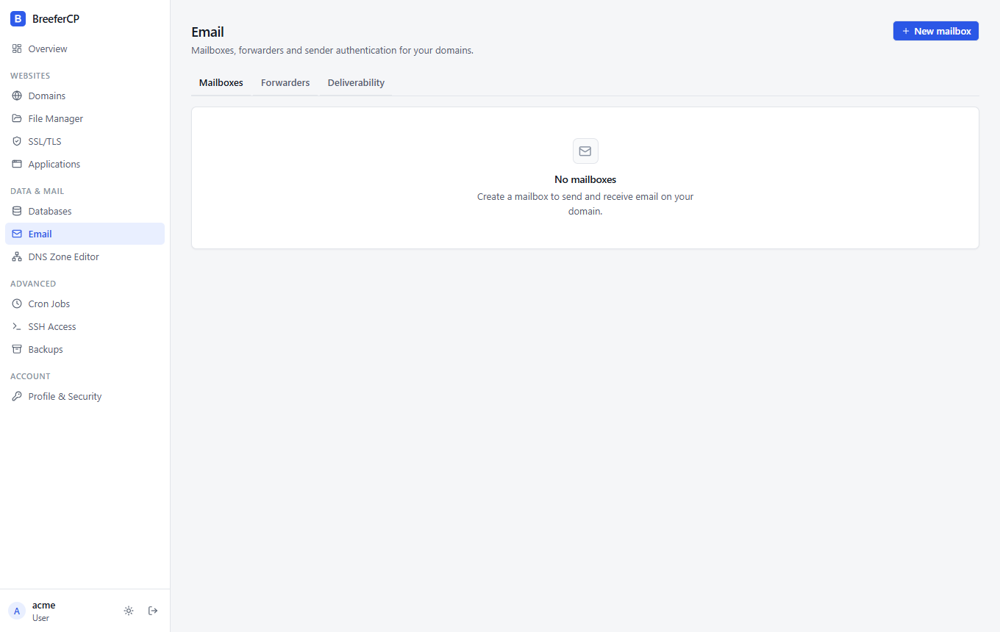
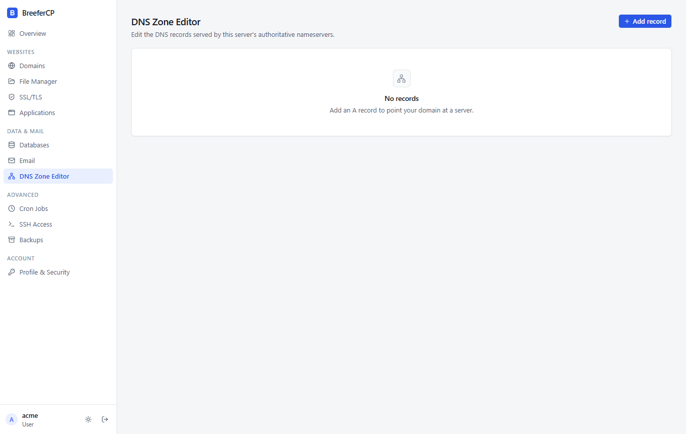

# Customer guide (cPanel role)

The **Overview** shows your plan, status and how much of each quota you have used.

## Domains

Add an **addon domain** (a separate site), a **subdomain**, or an **alias** (same content on another name). Choose the PHP version per domain. **Force HTTPS** turns on once the domain has a certificate. The primary domain cannot be removed.

## SSL/TLS

Click **Get free certificate** to issue a Let's Encrypt certificate for the domain and its `www` name. It renews automatically. The domain must already point at this server. To use your own certificate, choose **Upload** and paste the certificate chain and key; the panel checks that they match and cover the domain.

## File Manager

- Drag files onto the list or use **Upload**.
- Click a file to edit it (text files up to 5 MB; **Ctrl+S** saves). Click a folder to open it.
- Hover a row for rename, copy, permissions, download and delete. Select several rows to compress them to a zip or delete them together. Click a `.zip` to extract it here.
- You can only reach your own home directory. Your site files go in `public_html`.

## Databases

Create a database, create a user, then use **Add user to database**. Names are prefixed with your account name (`acme_shop`). Connect from your site with host `localhost`.

## Email

Create mailboxes with a quota, forwarders (use `*` as the name for a catch-all), and enable **DKIM** on the Deliverability tab, which also publishes a DMARC record. Mail clients: IMAP `mail.<yourdomain>` port 993 (SSL), SMTP port 587 (STARTTLS) or 465 (SSL), username is the full address.

## DNS Zone Editor

Add, replace or delete A, AAAA, CNAME, MX, TXT, NS, SRV and CAA records. Saving a record with the same name and type replaces the existing one. SOA records are managed by the server.

## Applications

Run Node.js, Python 3 or a Docker image. Put your code in `apps/<name>`, give a start command (the `PORT` environment variable is set for you) and optionally attach a domain; the panel proxies it for you. Applications run inside your account's CPU and memory limits.

## Cron jobs, SSH keys, backups

- **Cron jobs** run as your user on a schedule (pick a preset or write the five-field expression).
- **SSH access:** authorize a public key; connect with `ssh <user>@<yourdomain>` (shell access depends on your plan).
- **Backups:** create a full or databases-only backup and restore files from it later. Backups run in the background.

## Keep your account safe

Under **Profile & Security** change your password, enable two-factor authentication, and sign out other sessions.

## Dark theme

Use the sun/moon button next to your name in the sidebar to switch between light, dark and system.

